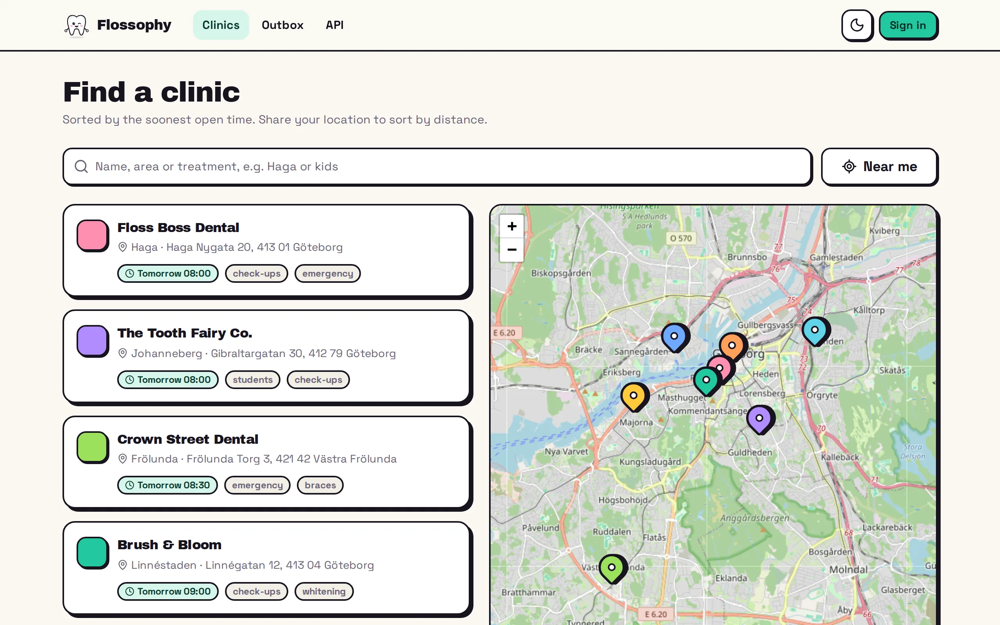
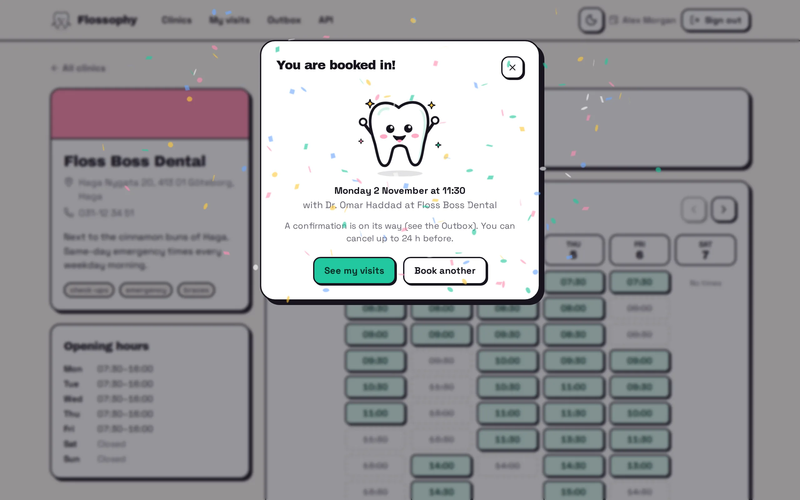
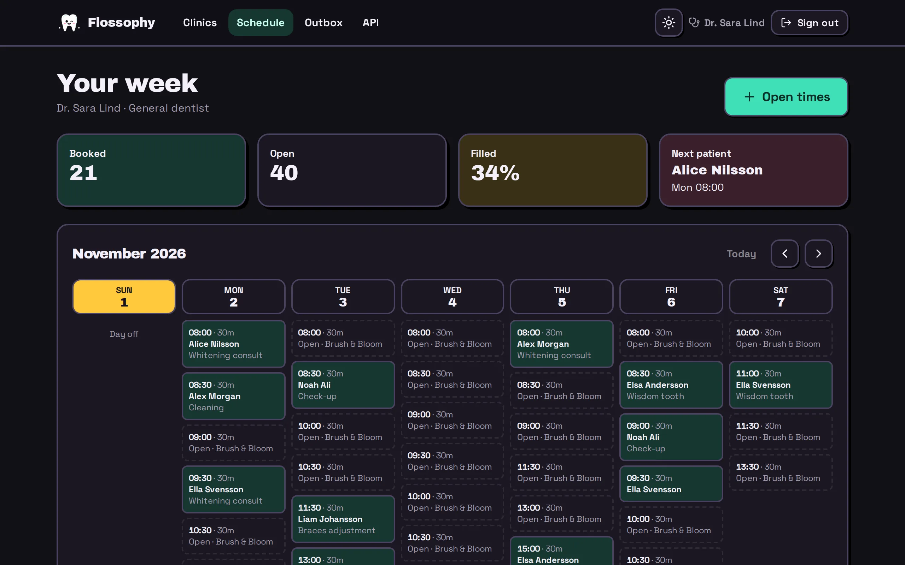
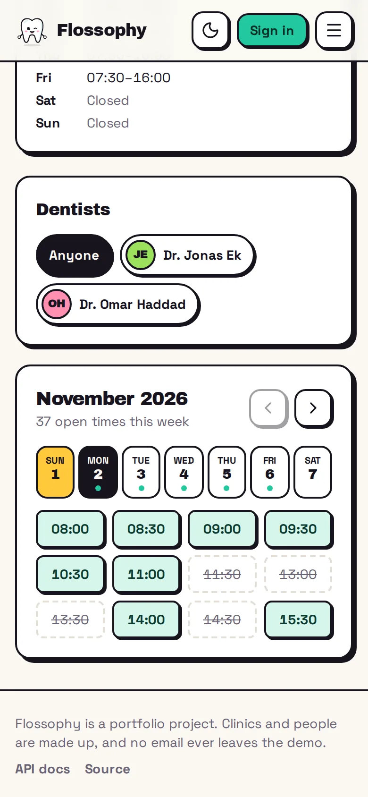
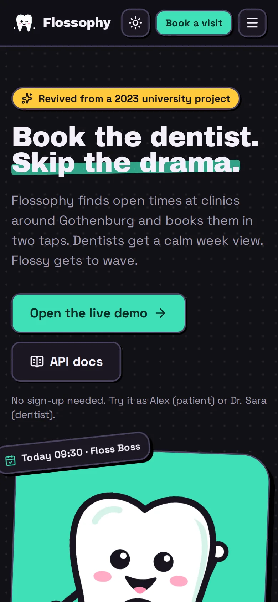

<p align="center">
  
</p>

<p align="center">
  Find an open time at a dentist near you and book it in two taps.<br>
  Dentists get a calm week view. Flossy gets to wave.
</p>

<p align="center">
  <a href="https://flossophy.lat0s.com"></a>
  <a href="https://flossophy.lat0s.com/api/docs"></a>
</p>

<p align="center">
  <a href="https://github.com/lat0s/flossophy/actions/workflows/ci.yml"></a>
  <a href="https://github.com/lat0s/flossophy/actions/workflows/codeql.yml"></a>
  
</p>

<p align="center">
  
</p>

## What it does

|                  |                                                                                         |
| ---------------- | --------------------------------------------------------------------------------------- |
| **Find**         | Search clinics by name, area or treatment, or sort them by distance from you.            |
| **Book**         | Pick a time from the week grid. Two people tapping the same time get one booking.       |
| **Manage**       | See upcoming and past visits, and cancel up to 24 hours before.                          |
| **Run the week** | Dentists see who is coming, open times in bulk and close the ones they cannot make.      |
| **Emails**       | Confirmations land in an in-app Outbox, so the demo never sends real mail.              |

<table>
  <tr>
    <td></td>
    <td></td>
  </tr>
  <tr>
    <td align="center"></td>
    <td align="center"></td>
  </tr>
</table>

## Run it locally

With Docker, one command:

```sh
git clone https://github.com/lat0s/flossophy && cd flossophy
docker compose up --build
# open http://localhost:8090
```

For development, you need Node 24+, pnpm and Docker:

```sh
pnpm install
docker run -d --name flossophy-mongo -p 127.0.0.1:27017:27017 mongo:7.0
cp apps/api/.env.example apps/api/.env && pnpm seed && pnpm dev
# open http://localhost:5173 and sign in as Alex (patient) or Dr. Sara (dentist)
```

`pnpm test`, `pnpm e2e`, `pnpm lint` and `pnpm typecheck` run the checks CI runs.

## How it is built

Vue 3 and Koa with MongoDB, all in TypeScript, sharing one set of zod schemas. The live demo
scales to zero: the API and database sleep when idle, and a small gate wakes them only for visitors
who passed a Cloudflare Turnstile check. Each visitor gets a private sandbox database.

Read more in [docs/ARCHITECTURE.md](docs/ARCHITECTURE.md).

## Background

Started as a university group project in 2023 (Vue + Koa + MongoDB). Rebuilt from scratch in 2026 as a
full-stack showcase.

The clinics and people are made up.
