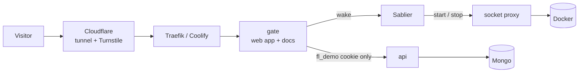

# Architecture

Flossophy is a pnpm monorepo with three apps and one shared package.

| Part              | What it does                                                                   | Stack                                     |
| ----------------- | ------------------------------------------------------------------------------ | ----------------------------------------- |
| `apps/web`        | The booking app for Patients and Dentists                                      | Vue 3, Pinia, TanStack Query, Tailwind 4  |
| `apps/api`        | REST API, sessions, booking rules, emails                                      | Koa 3, Mongoose 9, argon2, jose           |
| `apps/gate`       | Serves the web app, runs the bot check and wakes the API in the live demo      | Hono 4                                    |
| `packages/shared` | zod schemas and time helpers used by both sides, so types never drift          | zod 4, TypeScript 6                       |

## Domain

- **Clinic**: a practice with an address, opening hours and Dentists.
- **Slot**: a time a Dentist opened at a Clinic. It is open or booked.
- **Appointment**: a booked Slot, seen from the Patient's side.
- **Patient** books and cancels. **Dentist** opens and closes Slots and sees the week.

A booking is one atomic update: `findOneAndUpdate({ _id, booking: null })`. Two people tapping the same time
at once get one booking and one friendly 409. The API also checks a cap of 5 upcoming visits per Patient,
a 2-hour clash window, and a 24-hour cancel cutoff. All times are stored in UTC and shown in Europe/Stockholm.

## Code layout

Every app is split by feature, not by layer. A feature owns its model, routes and tests:

```
apps/api/src/features/{auth,clinics,slots,dentist,outbox,demo}
apps/web/src/features/{home,clinics,auth,account,dentist,demo,errors}
```

API routes are declared once with zod for params, body and response. That one declaration validates the
request, shapes the response and generates the OpenAPI document behind `/api/docs`.

## Live demo



- **Scale to zero.** The API and Mongo sleep after 15 idle minutes. The gate is tiny and always on. It
  serves the web app and the API docs, so browsing never wakes anything. The first API call from a visitor
  who passed the gate asks Sablier to start the API and Mongo, which takes about 20 seconds.
- **Bot gate.** Opening the demo needs a Cloudflare Turnstile pass. The gate then sets a signed,
  httpOnly `fl_demo` cookie for one hour. Without it, `/api` answers 401 and never wakes the API.
  Limits are 5 opens per IP per hour and 30 live sandboxes.
- **Sandboxes.** The cookie names a private database. Each visitor gets their own seeded copy of the
  clinic, dropped after an hour idle. Visitors never see each other's bookings. Emails go to an in-app
  Outbox and never leave the server.

## Security

- Sessions are HS256 JWTs in httpOnly, SameSite=Lax cookies, bound to the visitor's sandbox.
- Passwords use argon2id. Login has per-IP and per-account failure limits.
- Every write must come from the app's own Origin. JSON bodies are capped at 20 kB.
- Strict CSP, HSTS, `frame-ancestors 'none'`, nosniff and a tight Permissions-Policy.
- The gate sets the forwarding headers itself, so clients cannot spoof their IP or scheme to the API.
- Containers are read-only, run as non-root and drop all capabilities. Mongo uses auth. Sablier never
  touches the Docker socket directly: a proxy allows only list, inspect, start, stop and wait.
- CI runs CodeQL, `pnpm audit` and Dependabot.

## Tests

- **Vitest** covers the shared rules, the API against an in-memory Mongo with supertest (booking races,
  clashes, cutoffs, sandboxes), the gate, and Vue components.
- **Playwright** books and cancels a visit on desktop and phone.
